# CUE — Product Tour

**CUE is the AI Business Operating System for small businesses.**
Built by HASI Technologies · *The Heart of Your Business* · Demo industry: auto dealership · Available in **English, Spanish, Vietnamese, Arabic (full RTL)**.

Everything in CUE hangs off one operating loop:

> **Capture → Understand → Enhance → Execute → Expand**

Capture brings the business's reality in. Understand turns it into evidence. Enhance decides what to improve. Execute turns decisions into done work. Expand grows the people and the business. The sidebar is organized around these five loops.

---

## 1 · Public pages (no login)

### Landing (`/`)
Hero + the five loops as numbered cards; signed-in users go straight to their dashboard.

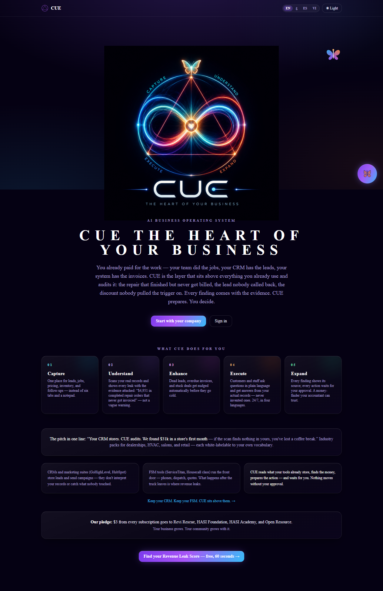

### Revenue Leak Score (`/score`)
Five questions, sixty seconds, one number: where the business is quietly losing money (unbilled work, slow follow-up, stalled handoffs), scaled to revenue bracket.

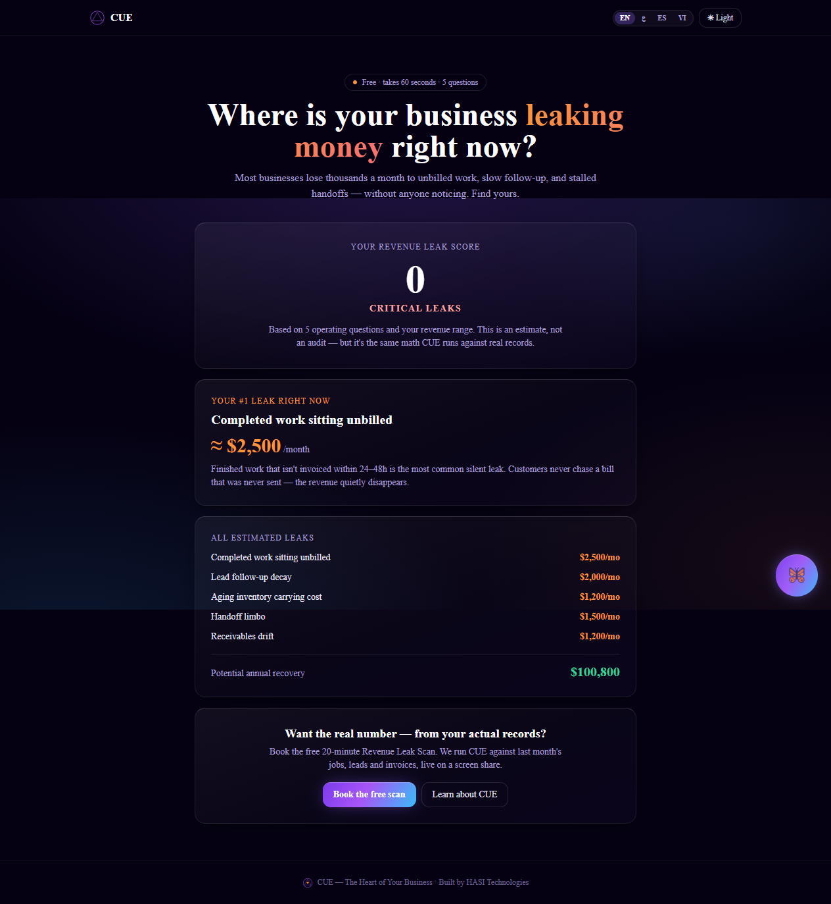

**Why it matters:** it quantifies the pain *before* the product is ever shown — the lead magnet for pilots.

### Book a walkthrough (`/book`)
A 20-minute "CUE scan call." Renders a live Calendly calendar when `CALENDLY_URL` is set; otherwise degrades honestly to an email contact block.

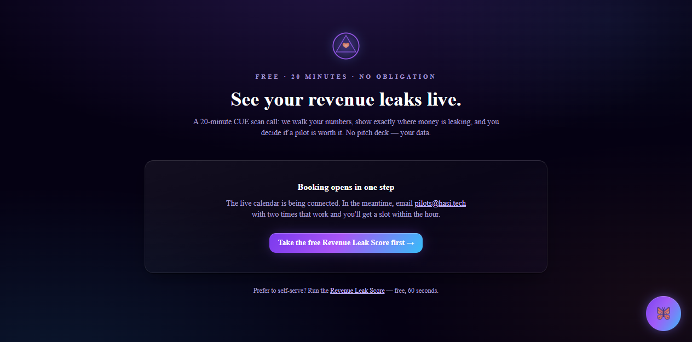

### Partner program (`/partners`)
Referral partners earn **50% recurring revenue**, with lifetime link attribution and automatic Stripe Connect splits (fair clawback on refunds). Degrades to a signup form when Stripe isn't configured.

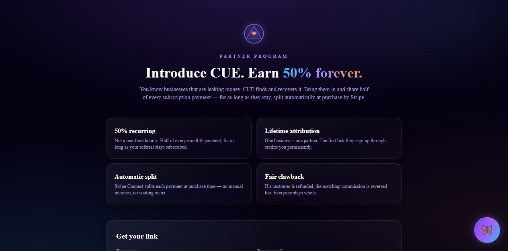

**Why it matters:** distribution without a sales team.

---

## 2 · Command

### Dashboard (`/dashboard`)
The morning view — essentials only: priority insight (with evidence drawer), business-health ring with grade, live number tiles (open insights · pending decisions · open tasks · revenue collected), recent activity, and recommended next actions.

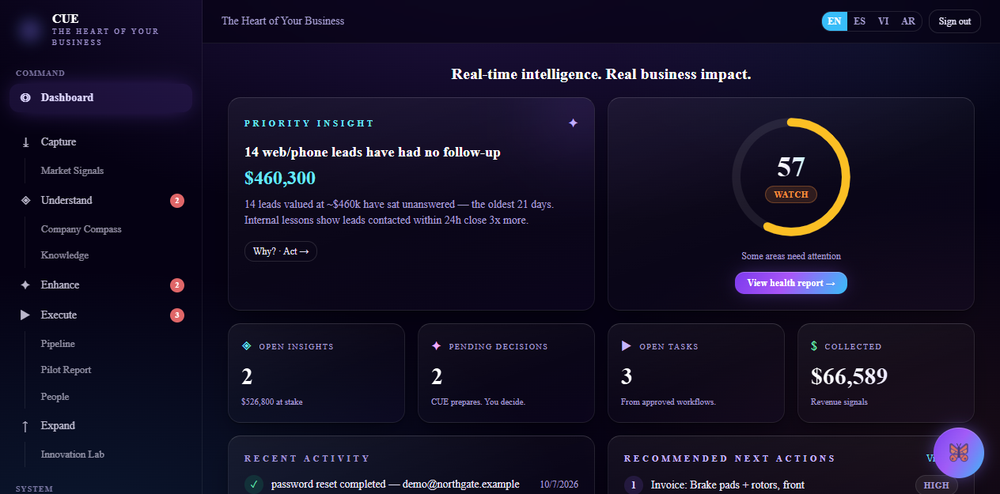

**How to use it:** open it first every day; act on the priority insight.
**Why it matters:** answers "what should I do today" in one glance.

### Sidebar pulse
The five loop parents show live attention counts — open insights (Understand), approvals waiting (Enhance), open tasks (Execute) — so the navigation itself tells you where attention is needed. Badges appear only for real open items.

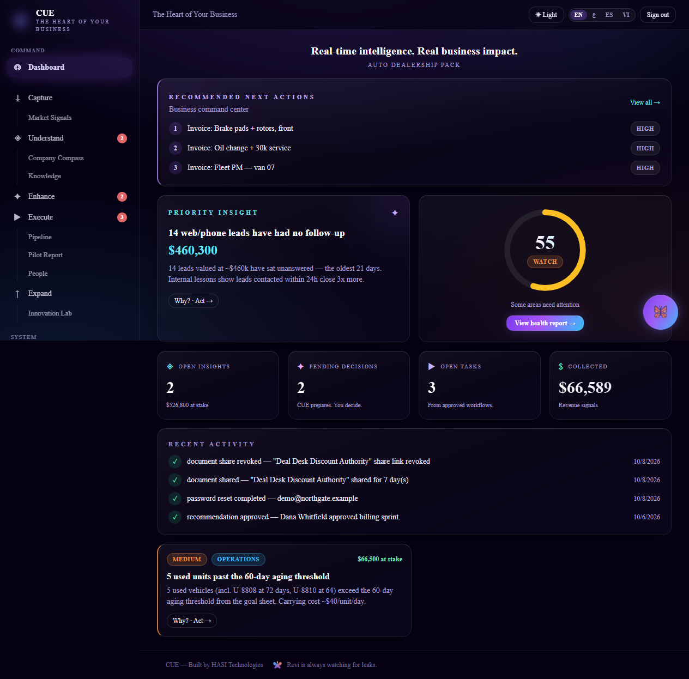

---

## 3 · Capture loop

### Capture (`/capture`)
Bring the business's reality in: documents (trade sheets, repair orders, invoices) via the Document Manager, stored in **private storage** and served through an authenticated signed-file route — no public URLs.

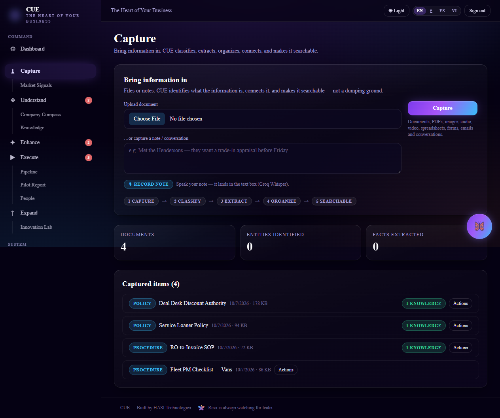

**Why it matters:** everything downstream is only as smart as what you capture.

### Market Signals (`/signals`)
Inbound market mentions and Google Business Profile activity land via authenticated webhooks (`/api/ingest/signals`, `/api/ingest/google`), deduped and classified by intent (BUY / SELL / SERVICE) — any signal converts to a lead or insight in one click.

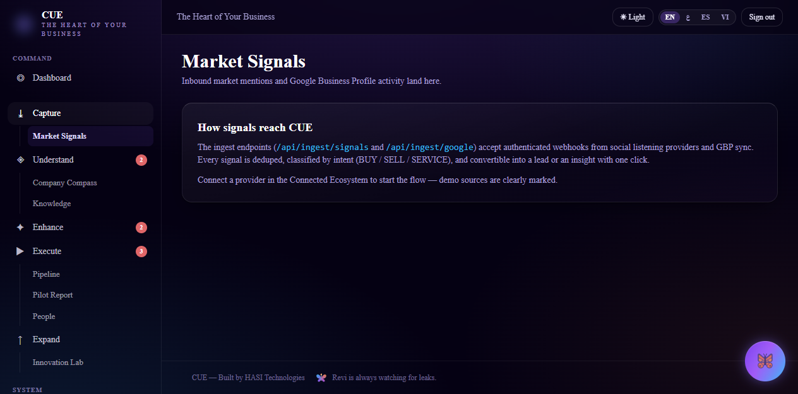

---

## 4 · Understand loop

### Understand (`/understand`)
Where CUE earns its keep: AI-generated insights with severity, dollar impact, and evidence ("vehicle listed 74 days, aging past your 45-day floor — $4,500 at stake"), plus recommendations awaiting your decision.

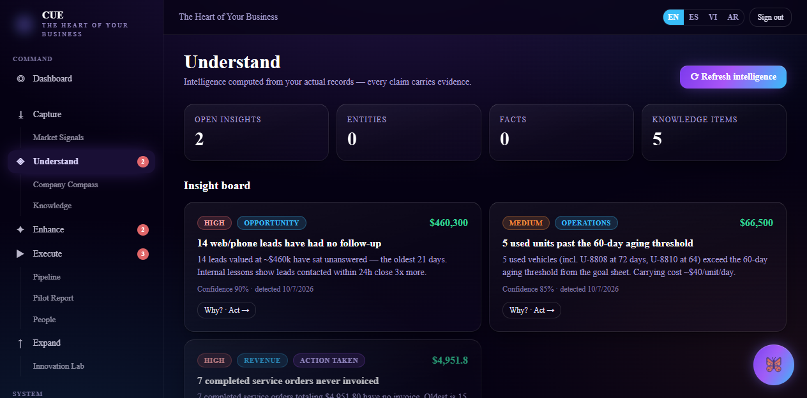

**Why it matters:** the shift from reporting to *telling you what to do*.

### Company Compass (`/compass`)
Business health across seven dimensions — revenue, pipeline, operations, inventory, customers, team, data — each with grade, drivers, evidence, and confidence.

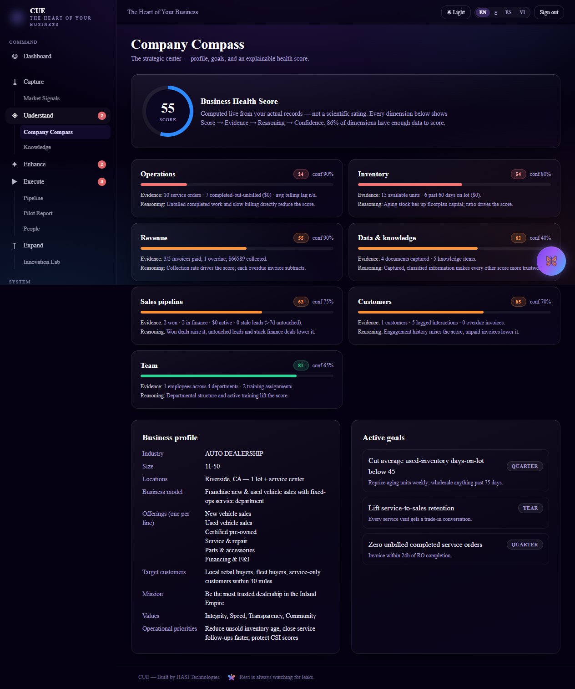

### Knowledge (`/knowledge`)
The institutional memory: policies, procedures, decisions, lessons — searchable and sourced. One-click example questions ("What is our discount authority?"); every answer cites its source.

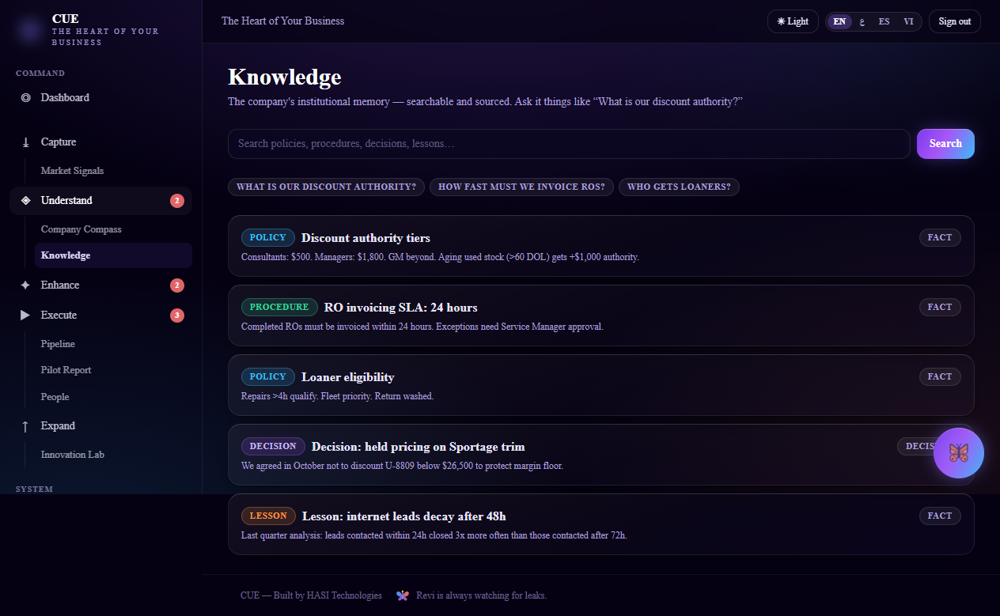

---

## 5 · Enhance loop

### Enhance (`/enhance`)
The improvement workshop, four tabs:

- **Pricing Studio** — industry-aware pricing (e.g., aging-vehicle repricing: days-on-lot + floor → suggested price + impact). **Capture** saves it locally; **Send for approval** creates a PENDING recommendation in Execute.
- **Brand Studio** — market-facing copy and offers.
- **CX signals** — customer-experience trends.
- **Process candidates** — friction points worth turning into workflows.

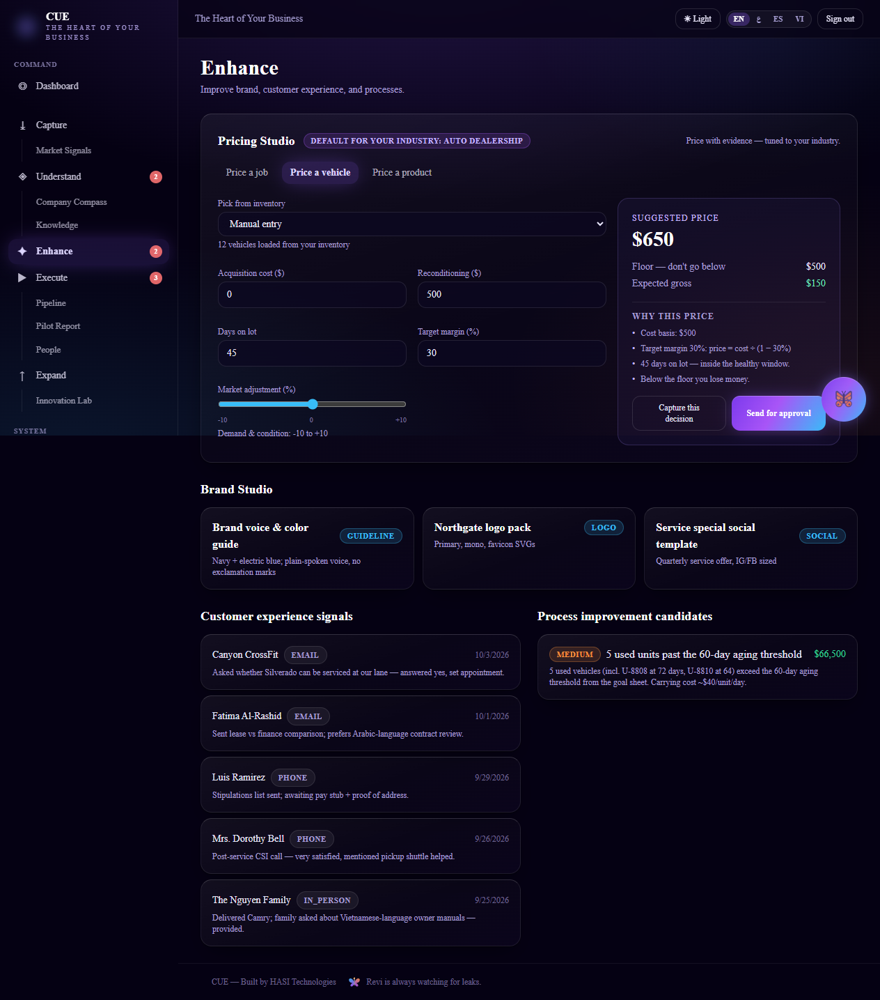

**Why it matters:** human judgment meets AI suggestion — nothing changes without an owner's decision.

---

## 6 · Execute loop

### Execute (`/execute`)
Where approved ideas become reality: **Approvals** (PENDING recommendations → Approve/Reject), **Workflows** (multi-step plays CUE generates), **Tasks** (assigned and tracked). Verified flow: approve a $4,515 repricing → *Create workflow* → workflow + open task with the price instruction attached.

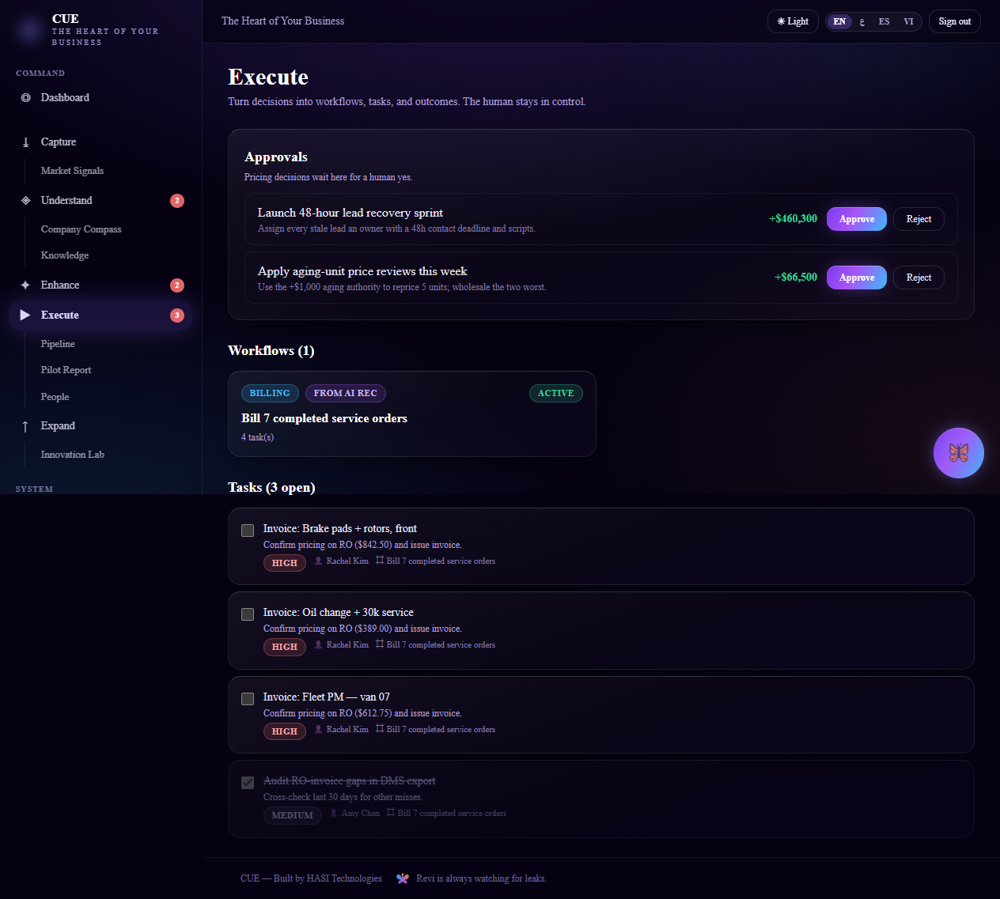

**Why it matters:** the loop actually *closes* — a decision becomes a done thing.

### Pipeline (`/pipeline`)
Leads, deals, inventory aging, service orders, and appointments in one dealership-aware view; 360° detail per lead/customer.

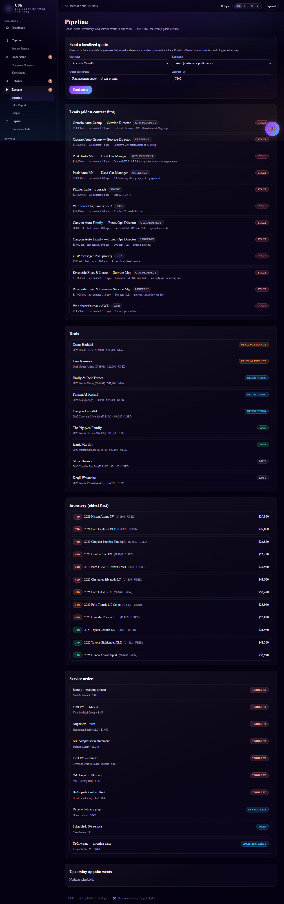

### Pilot Report (`/report`)
All real numbers: leaks found vs. acted vs. open, dollars at stake, the human-decision record (from the audit log), execution results, and dollars-recovered proxies.

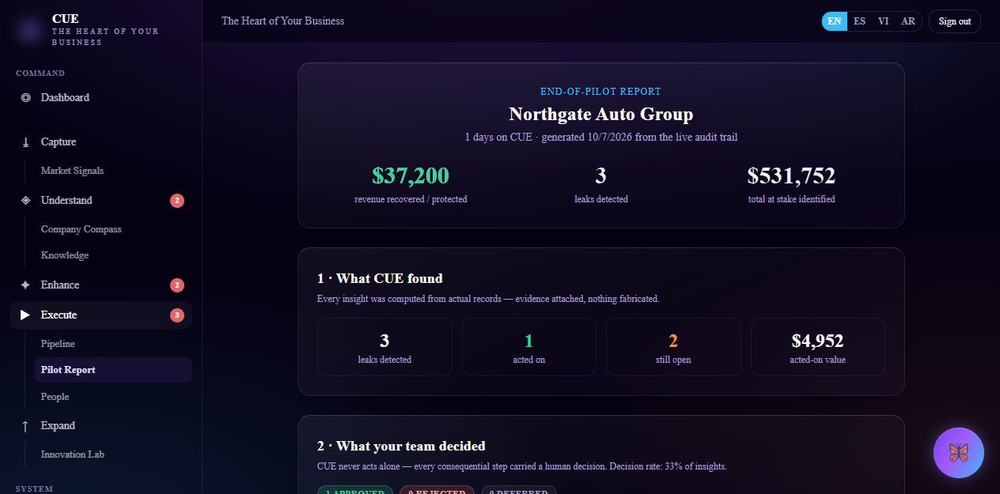

**Why it matters:** accountability — it shows the human was in charge and the money moved.

### People (`/people`)
Employees, departments, roles, open-task load, training assignments — the org context CUE reasons with.

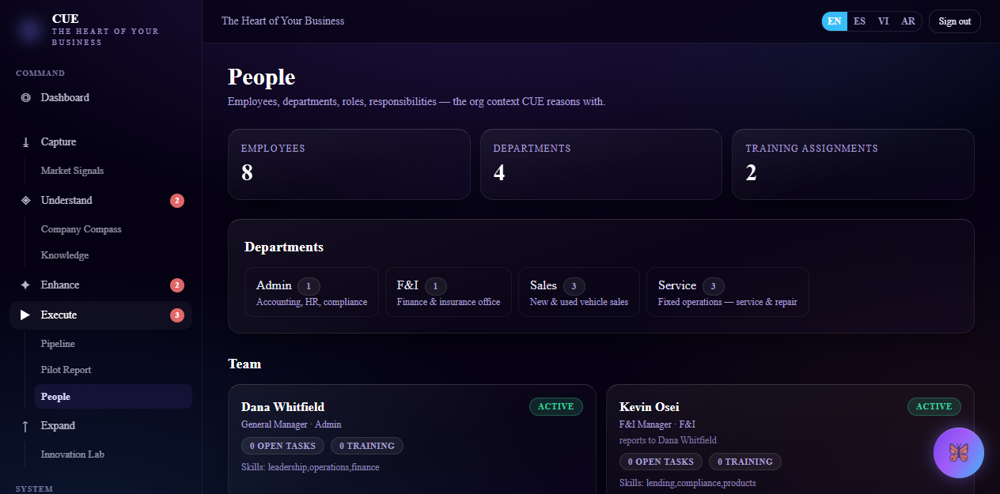

---

## 7 · Expand loop

### Expand (`/expand`)
- **Academy** — 3-lesson tracks (auto / service / salon) with DB-backed progress; owners/admins assign tracks to members ("Assigned to you" badge + team table).
- **Pitch generator** — industry-aware pitch copy.
- **Training library** — importable trainings with quizzes and team scores.
- **Scal³** — scaling-readiness model; plus opportunities and outcomes.

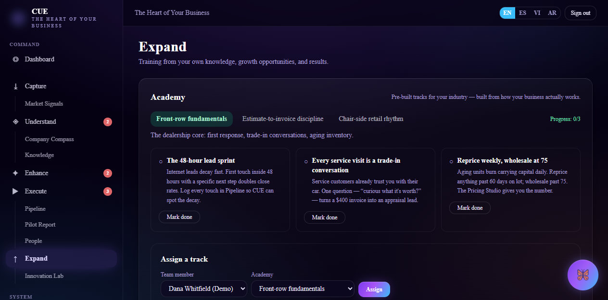

**Why it matters:** most software stops at dashboards; CUE trains the team and scales the system that was just fixed.

### Innovation Lab (`/lab`)
Ideas run as experiments — problem → hypothesis → solution → next step → status (IDEA → LAUNCHED).

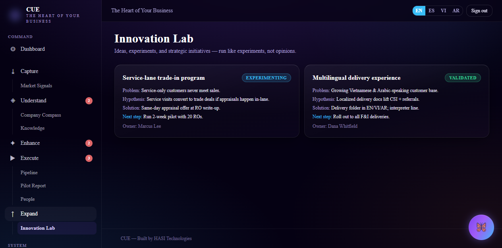

---

## 8 · System

### Connected Ecosystem (`/ecosystem`)
Every integration labeled honestly: **DEMO** (sample data), **AVAILABLE** (architecture ready, credentials pending), **CONNECTED** (live two-way).

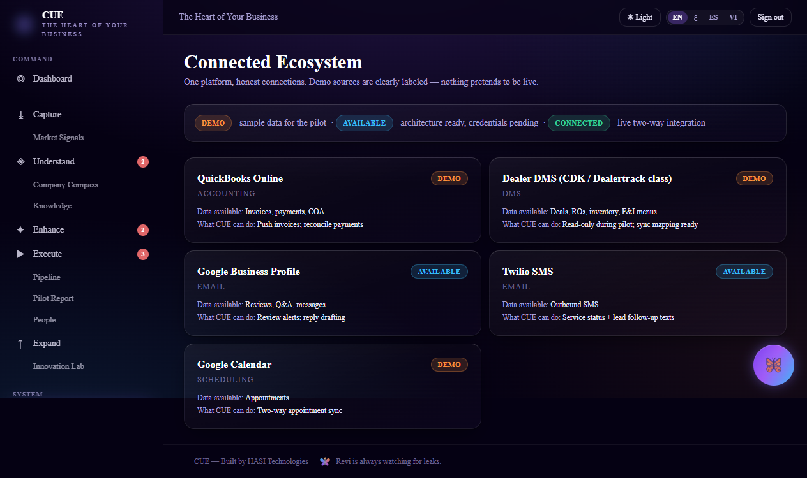

### Settings (`/settings`)
Profile, the **AI ladder** (how much autonomy CUE has), team/roles, and the full **audit trail**.

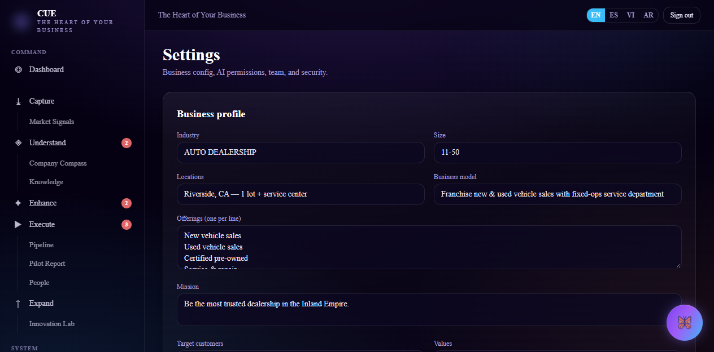

**Why it matters:** governance — what makes CUE enterprise-safe and fundable.

---

## Design commitments (visible everywhere)

1. **CUE prepares, you decide** — no action runs without a human approval.
2. **Honest degradation** — Stripe, Calendly, partners show real states; nothing pretends to be live; no fabricated stats.
3. **Every claim has evidence** — insights and answers cite the records behind them.
4. **Multilingual & RTL** — full EN/ES/VI/AR with mirrored Arabic layout.
5. **Industry-aware** — dealership-first language and logic, built to re-skin for the next vertical.

## Try the demo

Two demo organizations ship side by side — pick the vertical that matches the prospect:

**Northgate Auto Group (auto dealership)**
- OWNER: `demo@northgate.example` / `cue-demo-2026`
- ADMIN: `marcus@northgate.example` / `demo-admin-2026`
- MEMBER: `tom@northgate.example` / `demo-member-2026`

**Summit Air Heating & Cooling (HVAC)**
- OWNER: `demo@summitair.example` / `hvac-demo-2026`
- ADMIN: `rita@summitair.example` / `hvac-admin-2026`
- MEMBER: `chris@summitair.example` / `hvac-member-2026`

60-second path (either org): Dashboard → **Enhance → Pricing Studio** (send a price for approval) → **Execute → Approvals** (approve it) → **Create workflow** → task assigned → **Expand → Academy** (mark a lesson done, assign a track).

Re-seeding: `node --env-file=.env scripts/seed-dealership.mjs` / `scripts/seed-hvac.mjs` — each wipes and rebuilds only its own org. Rerunning a seed wipes that org's demo state (audit chain, Academy progress).

---

*CUE — The Heart of Your Business · Built by HASI Technologies*
