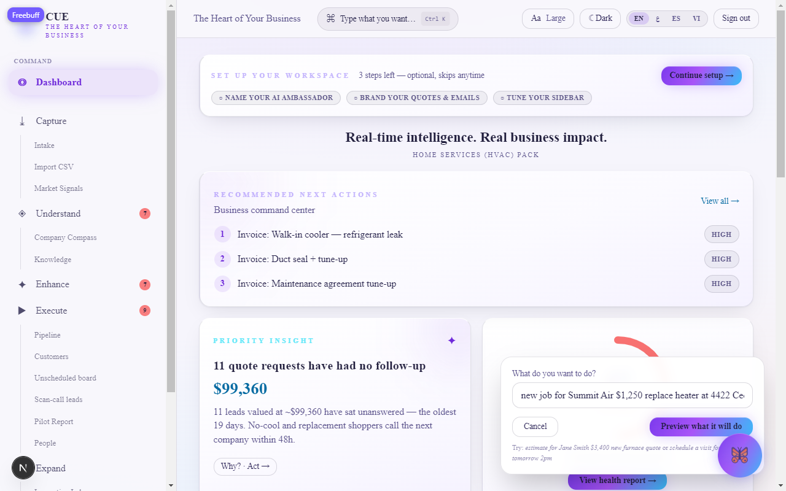
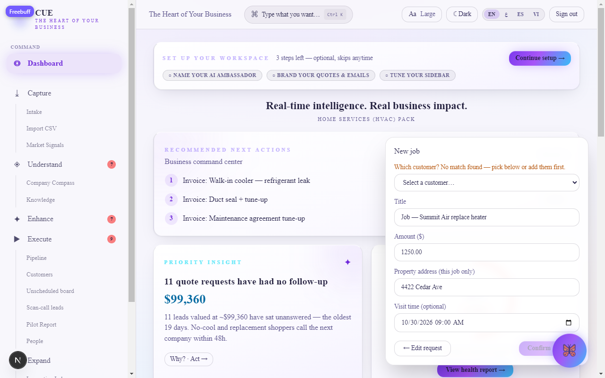
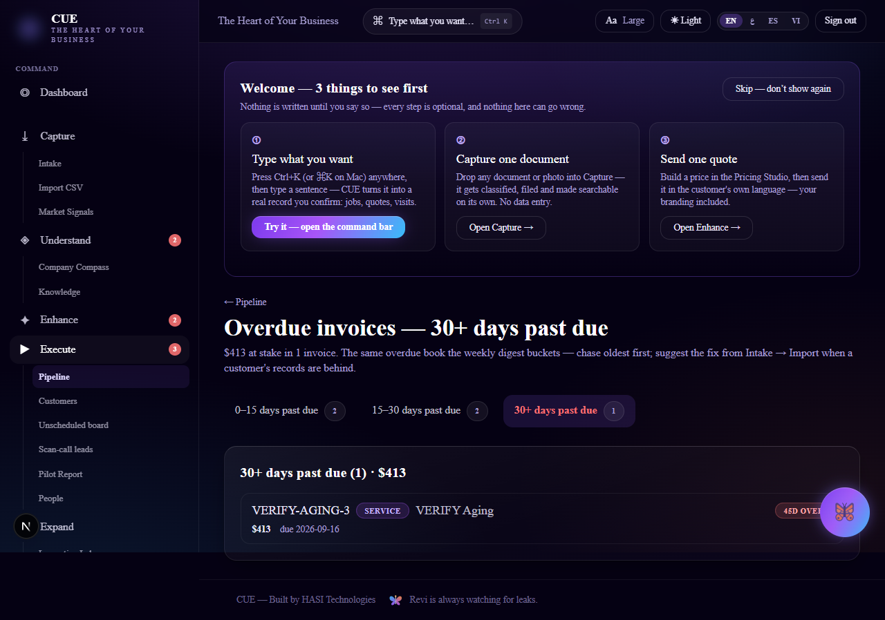
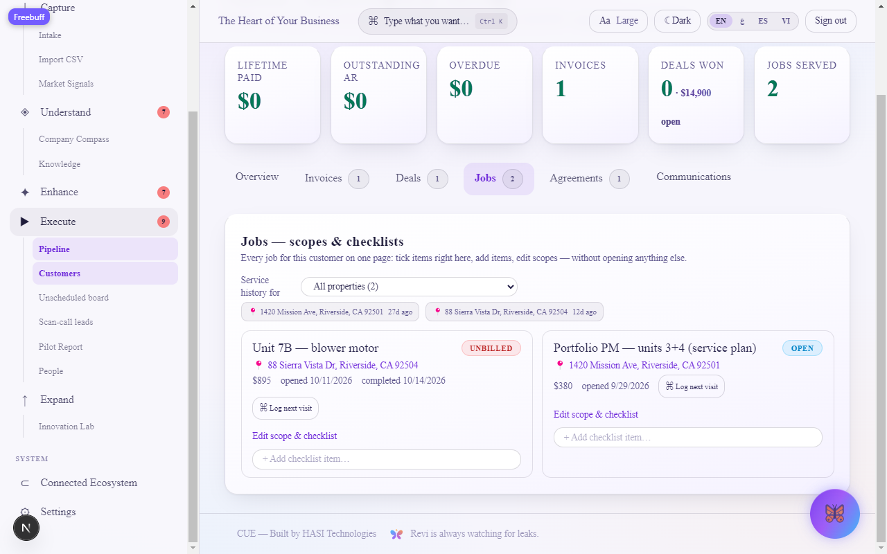
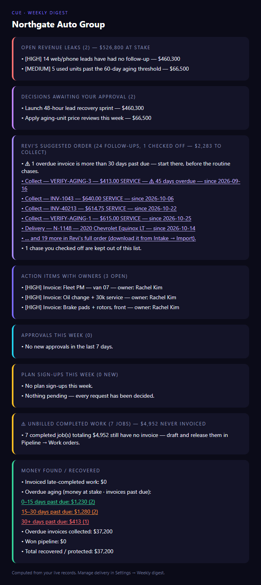

# CUE — Product Tour

**CUE is the AI Business Operating System for small businesses.**
Built by HASI Technologies · *The Heart of Your Business* · Demo industry: auto dealership · Available in **English, Spanish, Vietnamese, Arabic (full RTL)**.

Everything in CUE hangs off one operating loop:

> **Capture → Understand → Enhance → Execute → Expand**

Capture brings the business's reality in. Understand turns it into evidence. Enhance decides what to improve. Execute turns decisions into done work. Expand grows the people and the business. The sidebar is organized around these five loops.

---

## 1 · Public pages (no login)

### Landing (`/`)
Hero + the five loops as numbered cards; signed-in users go straight to their dashboard.

### Revenue Leak Score (`/score`)
Five questions, sixty seconds, one number: where the business is quietly losing money (unbilled work, slow follow-up, stalled handoffs), scaled to revenue bracket.

**Why it matters:** it quantifies the pain *before* the product is ever shown — the lead magnet for pilots.

### Book a walkthrough (`/book`)
A 20-minute "CUE scan call." Renders a live Calendly calendar when `CALENDLY_URL` is set; otherwise degrades honestly to an email contact block.

### Compare (`/compare`)
CUE versus the incumbent tools — the honest positioning page: CRMs and FSM tools store and run the front door, CUE sits above them auditing what happened after. Ends with the same two calls to action (free Revenue Leak Score, book the scan).

### Partner program (`/partners`)
Referral partners earn **50% recurring revenue**, with lifetime link attribution and automatic Stripe Connect splits (fair clawback on refunds). Degrades to a signup form when Stripe isn't configured.

**Why it matters:** distribution without a sales team.

---

## 2 · Command

### Dashboard (`/dashboard`)
The morning view — essentials only: priority insight (with evidence drawer), business-health ring with grade, live number tiles (open insights · pending decisions · open tasks · revenue collected), recent activity, and recommended next actions.

**How to use it:** open it first every day; act on the priority insight.
**Why it matters:** answers "what should I do today" in one glance.

**First-run tour:** on an owner's or manager's first sign-in, the dashboard shows a one-time **"Welcome — 3 things to see first"** card (① type what you want · ② capture one document · ③ send one quote). Each step opens the real feature; every step is skippable, and you can always find these later on your own. Staff and members get a single dismissible line about ⌘K instead — nothing to click through.

### Command bar (`⌘K` / Ctrl+K, anywhere)
Press the bar anywhere in the app and write a sentence: "new job for Summit Air $1,250 replace heater at 4422 Cedar Ave Friday 9am". CUE parses it deterministically — no AI needed, no invented customers — fills in a real record draft, and waits for **you** to confirm. Nothing is written until you press Confirm.

**Why it matters:** the fastest path to "I have a job to log" without knowing where anything lives.

### Workspace Studio — make the workspace yours
Three owner-tailorable layers, all backed by one per-org profile and wired through every branded surface:

1. **Ambassador persona** — name it, pick its avatar emoji **or upload a photo from your computer** (also available right on the wizard page), write its opening greeting, choose its voice (friendly / formal / concise / enthusiastic). The chat bubble on every page, its LLM voice, and the page footer all follow.
2. **Branding** — business name, **logo upload from your computer** (PNG/JPEG/WebP/SVG ≤200 KB, stored per-org and served from a stable public URL email clients can load) or a pasted URL, accent color, contact phone/email, theme default. These flow into **customer-facing quotes**, the **weekly digest email**, and the printed **leave-behind page**.
3. **Live preview** — before saving, render your choices through the *real* quote and digest builders with sample data in an in-page iframe. "Preview these unsaved edits" shows the form as-typed; "Preview saved branding" shows what's live now. Nothing is sent.
4. **Module layout** — hide modules you don't use and rename them to your vocabulary. The sidebar follows; disabled module routes fall back to the dashboard (Dashboard and Settings always stay).

Where to find it:
- **Wizard:** `/onboarding` — the guided 3-step setup for non-technical owners, skippable at every step — with an Ambassador photo upload right on the page (optional; the emoji stays as fallback).
- **DIY:** Settings → **Workspace Studio** — same controls, plus "Re-run the guided setup."
- **Prompt:** the dashboard shows a setup checklist card until the steps are done (owners/admins/managers only).

**Why it matters:** a workspace that adapts to the business — every branded artifact outgoing carries the owner's identity, not CUE's.

### Command bar — type what you want (`⌘K` / `Ctrl+K`)
A natural-language bar available on every signed-in page. Type a sentence like "new job for Summit Air $1,250 replace heater at 4422 Cedar Ave Friday 9am" and CUE parses it into a **draft card** — customer, amount, description, address, date — which you edit if needed and **Confirm**. Nothing is written until you confirm, and the parser is deterministic (no AI key, no hallucinated customers: unmatched names always ask).

Understanding: "schedule a visit for John Doe tomorrow 2pm" drafts an appointment; "estimate for Jane Smith $3,400 new furnace quote" drafts an estimate. On a job in **Execute**, a shortcut pre-fills the bar with that job's customer **and property**, so the tech starts from "new job for <customer>" without typing an address.

**Why it matters:** the fastest path from thought to record — and it works from any page, mid-task.

### Sidebar pulse
The five loop parents show live attention counts — open insights (Understand), approvals waiting (Enhance), open tasks (Execute) — so the navigation itself tells you where attention is needed. Badges appear only for real open items.

---

## 3 · Capture loop

### Capture (`/capture`)
Bring the business's reality in — every input lands here:

- **Document upload** — files are stored in **private storage** and served through an authenticated signed-file route; no public URLs.
- **Paste / voice note capture** — a pasted AI conversation becomes a formatted transcript doc; a spoken note transcribes (Groq Whisper) and files like any upload.
- **Automatic classification** — every capture is classified (POLICY / PROCEDURE / AI_CHAT / MEDIA / …), auto-filed into a folder, tagged, deduplicated by content hash (re-posts are blocked with a "Save anyway" choice), and made searchable in Knowledge immediately.
- **On-device OCR fallback** — with no Groq key configured, the browser's Tesseract extracts image text; extracted text is re-read, reclassified, and applied server-side as a real edit.
- **Extract & file / Assign re-read** — an image can be extracted after upload; after a policy edit, a manager assigns Everyone or a department to re-read it, and outstanding reads track on People → Reading queue.

**Why it matters:** everything downstream is only as smart as what you capture — classification, dedupe, and filing are CUE's job, not the staff's.

### Market Signals (`/signals`)
Inbound market mentions and Google Business Profile activity land via authenticated webhooks (`/api/ingest/signals`, `/api/ingest/google`), deduped and classified by intent (BUY / SELL / SERVICE) — any signal converts to a lead or insight in one click.

---

## 4 · Understand loop

### Understand (`/understand`)
Where CUE earns its keep: AI-generated insights with severity, dollar impact, and evidence ("vehicle listed 74 days, aging past your 45-day floor — $4,500 at stake"), plus recommendations awaiting your decision.

**Why it matters:** the shift from reporting to *telling you what to do*.

### Company Compass (`/compass`)
Business health across seven dimensions — revenue, pipeline, operations, inventory, customers, team, data — each with grade, drivers, evidence, and confidence.

### Knowledge (`/knowledge`)
The institutional memory: policies, procedures, decisions, lessons — searchable and sourced. One-click example questions ("What is our discount authority?"); every answer cites its source.

---

## 5 · Enhance loop

### Enhance (`/enhance`)
The improvement workshop, four tabs:

- **Pricing Studio** — industry-aware pricing (jobs from labor/parts/overhead; aging-vehicle repricing from days-on-lot + floor). Every suggestion shows **why this price** line by line; members can send their price upward for approval. **Capture** saves it into Knowledge; **Send for approval** creates a PENDING recommendation in Execute.
- **Service price book** — per-service labor rates (standalone vs cheaper add-on) plus named **assemblies** that bundle services into one quotable job; assemblies flow into quotes.
- **Quotes** — localized quote sending (EN/ES/VI/AR by customer preference), rendered from **your Workspace Studio brand** (name, logo, accent, contact footer).
- **Brand Studio** — market-facing copy and offers.
- **CX signals** — customer-experience trends.
- **Process candidates** — friction points worth turning into workflows.

**Why it matters:** human judgment meets AI suggestion — nothing changes without an owner's decision.

---

## 6 · Execute loop

### Execute (`/execute`)
Where approved ideas become reality: **Approvals** (PENDING recommendations → Approve/Reject), **Workflows** (multi-step plays CUE generates), **Tasks** (assigned and tracked, with owners and aging). Verified flow: approve a $4,515 repricing → *Create workflow* → workflow + open task with the price instruction attached.

### Accounts receivable (`/pipeline` → AR tile / /api/invoices + /api/reminders)
Two collection motions, both owner-approved before anything sends:
- **One-click payment reminders** — pull still-unpaid invoices into a WhatsApp-first (else email) nudge in the customer's own language.
- **Automated cadence** — approve the cadence once in Settings (every 3/7/14 days) and a daily cron runs it; paid invoices drop off automatically; the owner's custom message template (with per-language placeholders) overrides the built-in drafts.

### Pipeline (`/pipeline`)
Leads, deals, inventory aging, service orders, and appointments in one dealership-aware view; 360° detail per lead/customer; the **unscheduled board** groups unassigned maintenance work by area for dispatching; the property-filtered service history and next-visit hint live on each customer's Jobs tab. Service orders record the **property address** they were for, so a customer's Jobs tab groups history by location — open one property and you see just that address's visits, with a **"next visit due"** hint based on how long it's been since the last visit there. No more scrolling 30 locations for one address.

The overdue part of the book gets its own drill-down (`/pipeline/aging`): one bucket at a time — 0–15 / 15–30 / 30+ days past due — with the exact invoices behind each bucket and the money at stake up front. The weekly digest's colored aging chips deep-link here.

### Pilot Report (`/report`)
All real numbers: leaks found vs. acted vs. open, dollars at stake, the human-decision record (from the audit log), execution results, and dollars-recovered proxies.

**Why it matters:** accountability — it shows the human was in charge and the money moved.

### People (`/people`)
Employees, departments, roles, open-task load, training assignments — the org context CUE reasons with. Includes the **sales leaderboard** (closed units + gross by closer) and the clickable **weekly schedule** grid (AM/PM/DOUBLE/OFF; managers edit, everyone sees). **Maintenance-agreement renewals** surface on Understand when agreements are within 30 days of ending.

---

## 7 · Expand loop

### Expand (`/expand`)
- **Academy** — 3-lesson tracks (auto / service / salon) with DB-backed progress; owners/admins assign tracks to members ("Assigned to you" badge + team table).
- **Pitch generator** — industry-aware pitch copy.
- **Training library** — importable trainings with quizzes and team scores.
- **Scal³** — scaling-readiness model; plus opportunities and outcomes.

**Why it matters:** most software stops at dashboards; CUE trains the team and scales the system that was just fixed.

### Innovation Lab (`/lab`)
Ideas run as experiments — problem → hypothesis → solution → next step → status (IDEA → LAUNCHED).

---

## 8 · System

### Connected Ecosystem (`/ecosystem`)
Every integration labeled honestly: **DEMO** (sample data), **AVAILABLE** (architecture ready, credentials pending), **CONNECTED** (live two-way).

### Settings (`/settings`)
Business profile, vocabulary overrides with industry packs, the weekly digest (email + WhatsApp, chosen send day), AR reminder cadence + custom message template, text size and display accessibility, the **AI ladder** (how much autonomy CUE has), **Workspace Studio** (persona / branding / preview / modules — see §2), the AI Ambassador LLM key, team/roles, subscription (Stripe), Message-the-builder feedback, and the full **audit trail**.

The weekly digest email itself carries the chase list, the overdue-aging buckets and the checked-off tally: Revi's suggested order with a 30-day escalation nudge, followed by the money-found card where each aging bucket is colored (green 0–15 · orange 15–30 · red 30+ days) and clickable straight to the matching bucket in Pipeline → Overdue invoices.

**Why it matters:** governance — what makes CUE enterprise-safe and fundable.

---

## Design commitments (visible everywhere)

1. **CUE prepares, you decide** — no action runs without a human approval.
2. **Honest degradation** — Stripe, Calendly, partners show real states; nothing pretends to be live; no fabricated stats.
3. **Every claim has evidence** — insights and answers cite the records behind them.
4. **Multilingual & RTL** — full EN/ES/VI/AR with mirrored Arabic layout.
5. **Industry-aware** — dealership-first language and logic, built to re-skin for the next vertical.

## Try the demo

Two demo organizations ship side by side — pick the vertical that matches the prospect:

**Northgate Auto Group (auto dealership)**
- OWNER: `demo@northgate.example` — placeholder, **cannot log in** by design (see demo-owner caveat below)
- ADMIN: `marcus@northgate.example` / `northgate-demo-2026`
- MANAGER: `rachel@northgate.example` / `northgate-mgr-2026`
- MEMBER: `tom@northgate.example` / `northgate-staff-2026`

**Summit Air Heating & Cooling (HVAC)**
- OWNER: `demo@summitair.example` / `summit-demo-2026`
- ADMIN: `rita@summitair.example` / `summit-admin-2026`
- MANAGER: `sam@summitair.example` / `summit-mgr-2026`
- MEMBER: `chris@summitair.example` / `summit-staff-2026`

What each role can do (worst for best):
- **MEMBER** — staff: view Capture, Pipeline, Execute tasks, and the weekly schedule; read-only everywhere it counts (no approvals, no AR sends, no imports, no document edits, no schedule edits).
- **MANAGER** — staff oversight: everything MEMBER sees plus **schedule edits** (People → Weekly schedule) and **re-read assignment** (Capture → Assign re-read).
- **ADMIN** — all owner functions except the owner-only edges: weekly digest send, /monitor.
- **OWNER** — everything, including the two owner-only edges.

Walk-in-ready demo features (both industries):
- **People → Sales leaderboard** — closed units + gross by closer (dealship demos light up; hidden until deals carry a closer).
- **People → Weekly schedule** — clickable AM/PM/DBL/off grid; managers edit, everyone sees.
- **Capture → Assign re-read** — after a policy edit, assign Everyone or a department; outstanding reads track on **People → Reading queue**.

Demo-owner caveat: freshly seeded, the dealership OWNER account's hash is a placeholder and does not log in. `scripts/smoke-auth.mjs` provisions it with the `northgate-demo-2026` password as part of a smoke run, so that login works immediately after running the smoke script (or re-run the script when needed — it re-upserts).

60-second path (either org): Dashboard → **Enhance → Pricing Studio** (send a price for approval) → **Execute → Approvals** (approve it) → **Create workflow** → task assigned → **Expand → Academy** (mark a lesson done, assign a track).

Re-seeding: `node --env-file=.env scripts/seed-dealership.mjs` / `scripts/seed-hvac.mjs` — each wipes and rebuilds only its own org. Rerunning a seed wipes that org's demo state (audit chain, Academy progress).

---

*CUE — The Heart of Your Business · Built by HASI Technologies*
